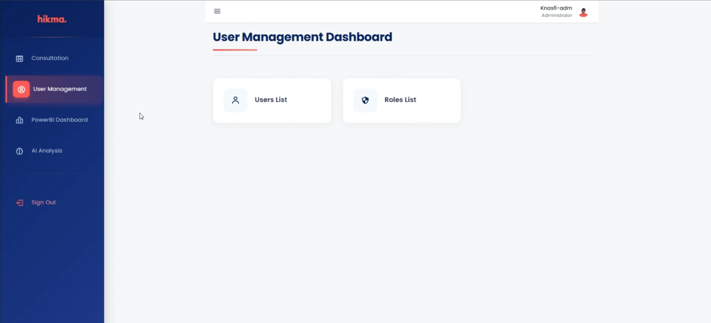
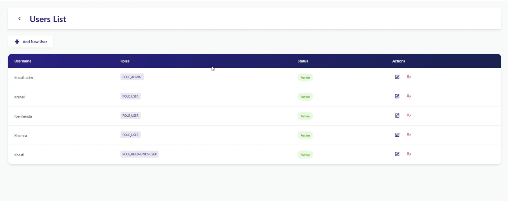
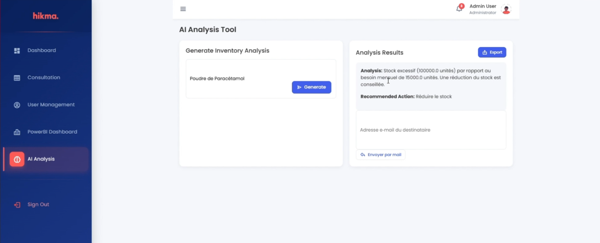

# Project : Internal Planning & Management Platform

A full-stack platform for internal planning and management, built with
**Spring Boot** and **Angular**.

## Features

- **Planning & internal management**: create, track and manage planning data
- **Secure GraphQL APIs**: authentication with JWT and LDAP, role-based access control
- **AI-assisted stock suggestions**: recommendations based on stock data
- **Dynamic dashboards**: interactive charts and visualizations
- **Automatic business calculations**
- **ETL pipeline & scheduled jobs**: automated data processing
- **Performance testing**: load tests with Apache JMeter

## Tech Stack

| Layer | Technologies |
|---|---|
| Backend | Java, Spring Boot, Spring Security, GraphQL |
| Frontend | Angular, TypeScript, Apollo Client |
| Database | Microsoft SQL Server |
| Security | JWT, LDAP, role-based access |
| Data | ETL pipeline, scheduled jobs |
| Testing | Apache JMeter |

## Screenshots

## Getting Started

### Prerequisites
- Java 17+ (adjust to your version)
- Node.js 18+ and npm
- SQL Server instance
- Maven

### Backend

    cd Springboot/hikmaproject
    mvn spring-boot:run

Set these environment variables first:

| Variable | Description |
|---|---|
| `DB_URL` | SQL Server JDBC URL |
| `DB_USERNAME` | Database user |
| `DB_PASSWORD` | Database password |
| `JWT_SECRET` | Secret used to sign tokens |
| `LDAP_URL` | LDAP server URL |

### Frontend

    cd Angular/hikmaprj
    npm install
    ng serve

Open http://localhost:4200

## Project Structure

    mrpval/
    ├── Angular/hikmaprj/        # Angular frontend
    ├── Springboot/hikmaproject/ # Spring Boot backend
    └── docs/screenshots/        # README images